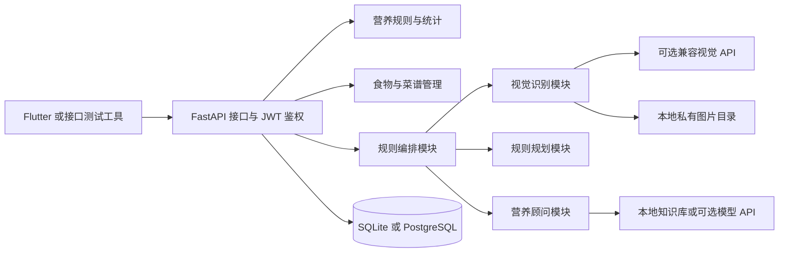

# 智能饮食搭配推荐系统后端设计与实现

## 交付范围

本实现围绕项目计划书的 MVP 闭环：账号与档案、营养目标、手动或照片确认记录、营养统计、三套以上候选推荐、营养顾问对话。交付形式为独立后端源码与资料包，不包含 Flutter 客户端、真实付费模型账户或云服务器。

## 架构

接口层负责校验、身份与响应，业务服务负责规则、计算与外部适配。鉴权从 Token 得到用户编号，个人数据的读取、修改、删除均同时检查归属，不接受客户端指定其他用户身份。

## 数据模型

| 表 | 作用 |
| --- | --- |
| users | 用户、密码哈希、角色、Token 版本 |
| user_profiles | 每用户一份身体档案和目标 |
| nutrition_targets | 每用户每日唯一的目标快照与档案依据 |
| foods | 每100克食物营养、别名与来源 |
| recipes | 菜谱说明、目标标签、参考做法和每份营养 |
| recipe_ingredients | 菜谱与食物的对应及克数 |
| meal_records | 单种食物的实际摄入记录及营养快照 |
| uploaded_images | 用户私有图片元数据 |
| recognitions | 识别状态、候选食物及确认记录编号 |
| ai_conversations | 用户咨询会话 |
| ai_messages | 会话消息、来源和回答模式 |

为延续练习版已验证的接口，本版每条 `meal_records` 直接表示一种食物，一餐多种食物保存多条记录，按日期和餐次汇总。计划书中的独立 `meal_items` 拆分暂未采用；这种差异不影响现有手动记录、统计与菜谱记录接口。

## 营养目标规则

静息能量估算采用 Mifflin–St Jeor 简化公式：

- 男性：`10 × 体重kg + 6.25 × 身高cm − 5 × 年龄 + 5`。
- 女性：`10 × 体重kg + 6.25 × 身高cm − 5 × 年龄 − 161`。

原研究预测的是静息能量消耗；为对应计划书，接口沿用 `bmr_kcal` 命名，不能视为直接测量值。[原始论文](https://pubmed.ncbi.nlm.nih.gov/2305711/)

活动系数采用计划书中的久坐 1.2、轻度 1.375、中度 1.55、高度 1.725、极高 1.9。TDEE 为估算静息消耗乘活动系数。

| 目标 | 能量乘数 | 蛋白质克数每千克体重 |
| --- | ---: | ---: |
| 减脂 | 0.85 | 2.0 |
| 增肌 | 1.10 | 1.8 |
| 维持 | 1.00 | 1.2 |
| 塑形 | 1.00 | 1.6 |

前两项从计划书给定区间内选取固定值，后两项为本原型补充的明确参数，均不是普遍适用的医学标准。脂肪按目标能量的 25% 换算为克，碳水为剩余能量除以4；蛋白质与碳水按每克4千卡，脂肪按每克9千卡计算。总能量采用计划书中的“不低于估算静息消耗”规则。若输入导致非正静息消耗或非正碳水配额，返回422并要求核对档案。

目标首次查询时持久化保存，版本为 `mvp-1.0`。重算明确限于今天或未来日期，防止档案变化静默修改历史结果。日期默认按 UTC+8 的当天，饮食记录日期由客户端显式提交。

本功能面向成人一般营养参考，孕哺期及疾病饮食需要专业评估，不能把计算值当作处方。[NIDDK 工具适用范围说明](https://www.niddk.nih.gov/health-information/weight-management/body-weight-planner)

## 推荐规则

早餐、午餐、晚餐、加餐的原型能量分配比例分别为30%、35%、30%、5%。候选菜谱按与当前剩余能量、蛋白质配额的偏差排序，并给匹配目标标签的菜谱适当加分；同分时按编号排序，保证结果稳定可解释。

默认返回3套，最大10套，每套包含每份营养、食材克数与参考做法。显式排除食材后不足3套会如实说明，不补造结果；当日热量目标已达到时明确标记仅为备选，不表示需要继续进食。未实现自动过敏识别、慢病禁忌推断或协同过滤。

## 图片与 AI 模块

上传只接受经实际解码校验的JPEG、PNG、WEBP，原文件最大8MB，像素最大两千万；标准化为最大2048像素JPEG，去除EXIF后按随机编号保存。图片只通过带Bearer凭证的私有接口读取。

视觉接口为兼容 Chat Completions 的适配器，返回候选名称与置信度；本地营养值通过食物库补全。无配置、未同意外传、供应商故障、返回格式不正确或无结果时都进入明确的手动确认流程。用户确认后才产生饮食记录；确认操作使用数据库条件更新，防止重复提交写入两次。

营养顾问默认检索本地知识库，返回来源链接及 `local_knowledge`。配置模型、开启外部能力且请求明确同意外传后才调用外部模型；失败时回到本地回答。会话按账号隔离，可单独删除。模块不提供疾病诊断、用药处方或极端节食方案。

编排采用规则路由，分别调用识别、规划、顾问或统计服务。这里的Agent表示职责明确的功能模块，不代表已经部署独立的多模型自主协作系统。

## 权限与工程约束

- 普通账号只能修改自己的档案、饮食、会话及图片；管理员才能维护公共食物和菜谱。
- 密码使用Argon2哈希，JWT固定验证算法、签发方、接收方、过期时间与Token版本；退出登录使旧版本凭证失效。
- SQLite连接启用外键检查；公共食物、菜谱采用停用而非直接物理删除。
- CSV整批校验后再写入，识别确认、菜谱记录与账号删除按数据库事务处理。
- 本机进程内限流按IP与接口类别计算，适用于单实例演示。多实例部署需替换为Redis等共享限流方案。
- 公开接口错误附带请求编号，不回显密码、外部密钥或供应商错误正文。

## 与计划书的待验收差异

本包不宣称完成500条权威食物、200套菜谱、真实照片准确率80%、份量误差指标、真实第三方服务延迟、Flutter端到端操作步数、云端50用户持续负载或真实PostgreSQL服务验收。当前包含的数据与测试规模在测试报告中如实列明，接口已提供后续补充数据和外部能力的入口。
